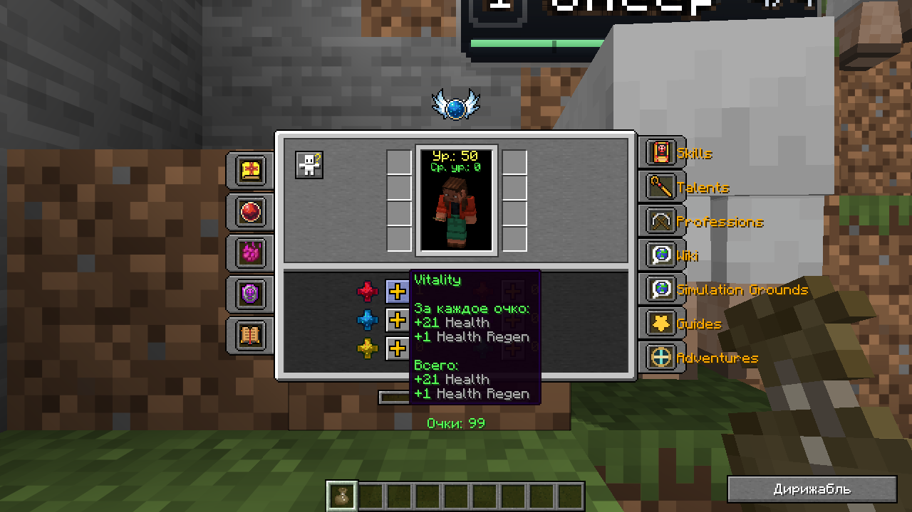
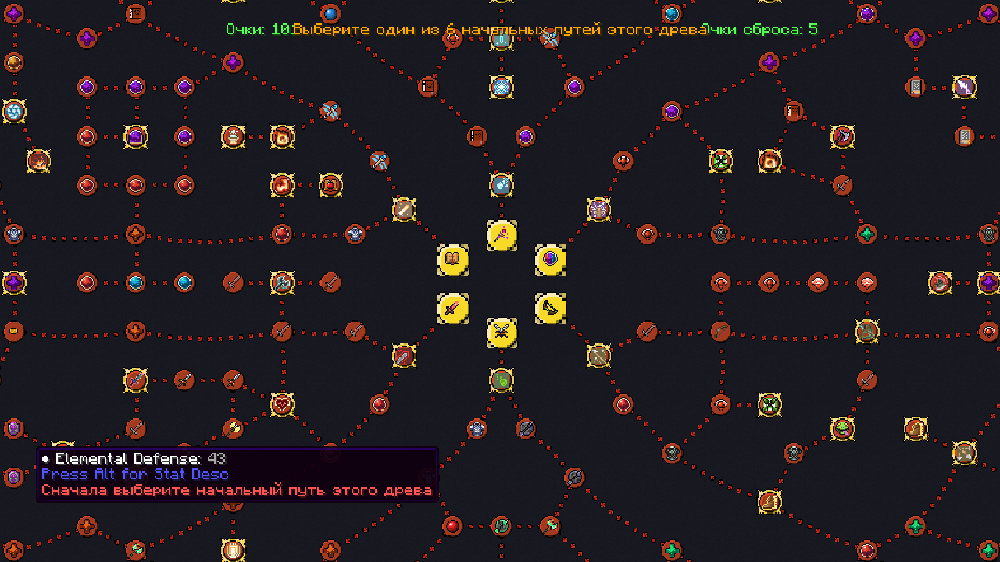
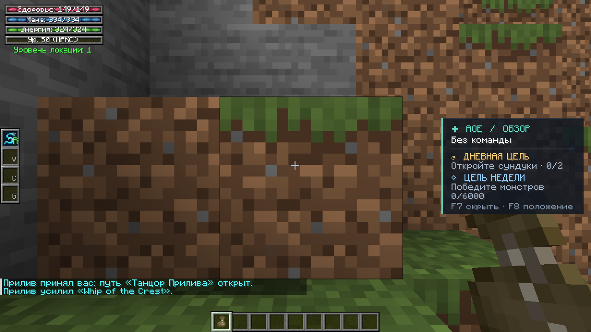
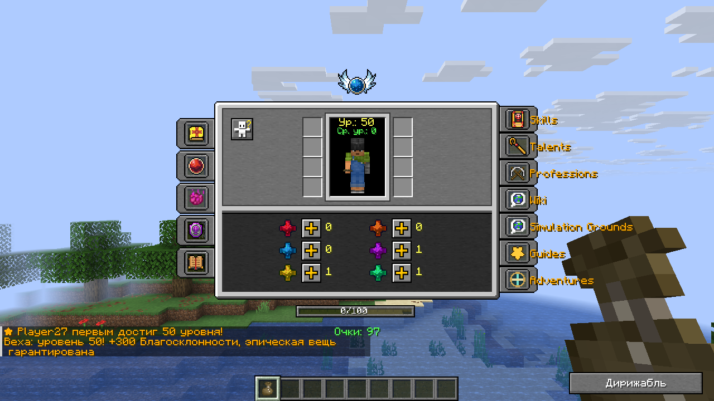
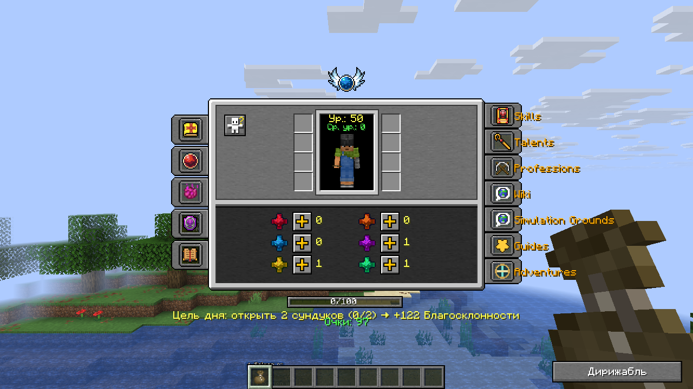
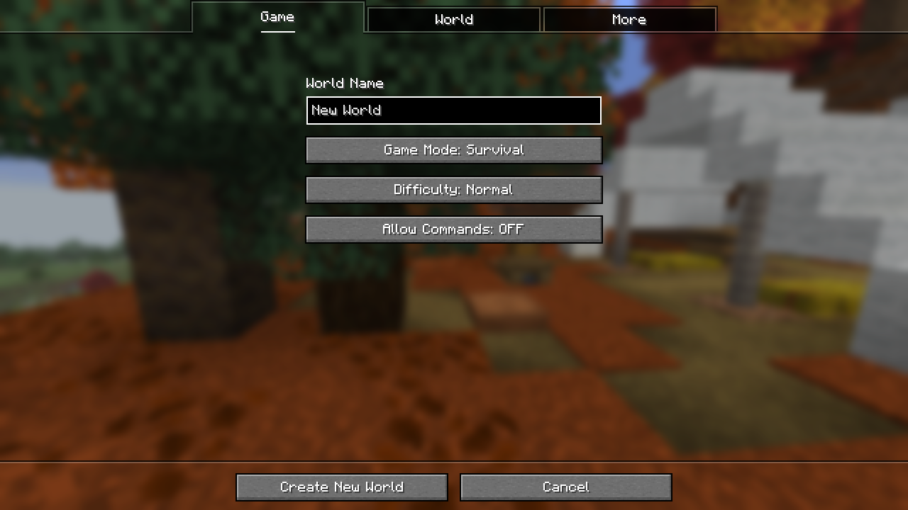

# Полный цикл: прокачка, GUI и умения — видео и снимки

Обновлено: 2026-11-22 20:50 UTC · коммит `52f47dbfda698a59b6d78a3f6e9e901b833c1b24` · [прогон](https://github.com/Antoniumu/Age-of-Epoch/actions/runs/45066701349)

Ветку перезаписывает workflow `.github/workflows/gameplay-e2e.yml` — здесь всегда последний результат.

## 1. Прокачка (видео по этапам)

**Итог:** `[20:35:38] [Server thread/INFO] (AgeOfEpoch-Progression) AOEPROG done passed=11 failed=0 level=50/50`

Каждый ролик — этап: набор опыта (в кадре «+N опыта» и level-up), вложение очков, выбор пути Вознесения, цепочка умений, хотбар.

* [▶ alloc_spell](videos/progression/alloc_spell.mp4) · [постер](videos/progression/alloc_spell.png)
* [▶ alloc_stats](videos/progression/alloc_stats.mp4) · [постер](videos/progression/alloc_stats.png)
* [▶ ascend_alloc](videos/progression/ascend_alloc.mp4) · [постер](videos/progression/ascend_alloc.png)
* [▶ ascend_pick](videos/progression/ascend_pick.mp4) · [постер](videos/progression/ascend_pick.png)
* [▶ hotbar](videos/progression/hotbar.mp4) · [постер](videos/progression/hotbar.png)
* [▶ intro](videos/progression/intro.mp4) · [постер](videos/progression/intro.png)
* [▶ level_10](videos/progression/level_10.mp4) · [постер](videos/progression/level_10.png)
* [▶ level_25](videos/progression/level_25.mp4) · [постер](videos/progression/level_25.png)
* [▶ level_50](videos/progression/level_50.mp4) · [постер](videos/progression/level_50.png)
* [▶ verify](videos/progression/verify.mp4) · [постер](videos/progression/verify.png)

Отчёт: [`reports/progression-report.md`](reports/progression-report.md)

## 2. Клики в GUI (видео)

Сценарий кликает настоящей мышью по реальным координатам виджетов (дамп клиента),
а сервер подтверждает каждый пакет строкой `AOEGUI packet=... ok=...`.

```
[20:41:22] [Server thread/INFO] (AgeOfEpoch-GuiPackets) AOEGUI packet=stat_alloc stat=vitality ok=true free_after=99
[20:41:26] [Server thread/INFO] (AgeOfEpoch-GuiPackets) AOEGUI packet=spell_alloc spell=poison_ball school=nature ok=true
[20:41:30] [Server thread/INFO] (AgeOfEpoch-GuiPackets) AOEGUI packet=ascension_pick class=tide_dancer ok=true
[20:41:32] [Server thread/INFO] (AgeOfEpoch-GuiPackets) AOEGUI packet=ascension_alloc spell=tidewhip_lash ok=true rank=1
```

[▶ Смотреть gui-video.mp4](videos/gui/gui-video.mp4)

## 3. Все умения (видео по классам)

**Итог:** `AOEAI done spells=78 passed=78 failed=0`

* [▶ divine](videos/spells/divine.mp4) · [постер](videos/spells/divine.png)
* [▶ fire](videos/spells/fire.mp4) · [постер](videos/spells/fire.png)
* [▶ hunting](videos/spells/hunting.mp4) · [постер](videos/spells/hunting.png)
* [▶ nature](videos/spells/nature.mp4) · [постер](videos/spells/nature.png)
* [▶ no_school](videos/spells/no_school.mp4) · [постер](videos/spells/no_school.png)
* [▶ water](videos/spells/water.mp4) · [постер](videos/spells/water.png)

Отчёт: [`reports/spell-audit.md`](reports/spell-audit.md)

## Снимки (35)

**gui-00-main-menu**

[](shots/gui-00-main-menu.png)

**gui-01-world-list**

[](shots/gui-01-world-list.png)

**gui-02-in-world**

[](shots/gui-02-in-world.png)

**gui-02b-in-world-created**

[](shots/gui-02b-in-world-created.png)

**gui-05-progressed-to-50**

[](shots/gui-05-progressed-to-50.png)

**gui-10-character-screen**

[](shots/gui-10-character-screen.png)

**gui-11-stat-allocated**

[](shots/gui-11-stat-allocated.png)

**gui-20-spell-screen**

[](shots/gui-20-spell-screen.png)

**gui-21-spell-learned**

[](shots/gui-21-spell-learned.png)

**gui-30-ascension-classes**

[](shots/gui-30-ascension-classes.png)

**gui-31-path-picked**

[](shots/gui-31-path-picked.png)

**gui-32-node-allocated**

[](shots/gui-32-node-allocated.png)

**gui-33-node-hotbar**

[](shots/gui-33-node-hotbar.png)

**gui-40-talents-screen**

[](shots/gui-40-talents-screen.png)

**gui-41-perk-clicked**

[](shots/gui-41-perk-clicked.png)

**gui-50-professions**

[](shots/gui-50-professions.png)

**gui-60-back-in-world**

[](shots/gui-60-back-in-world.png)

**progression-00-main-menu**

[](shots/progression-00-main-menu.png)

**progression-01-world-list**

[](shots/progression-01-world-list.png)

**progression-02-in-world**

[](shots/progression-02-in-world.png)

**progression-02b-in-world-created**

[](shots/progression-02b-in-world-created.png)

**progression-10-level-10-hud**

[](shots/progression-10-level-10-hud.png)

**progression-11-level-10-character**

[](shots/progression-11-level-10-character.png)

**progression-20-level-25-hud**

[](shots/progression-20-level-25-hud.png)

**progression-21-level-25-character**

[](shots/progression-21-level-25-character.png)

**progression-30-level-50-hud**

[](shots/progression-30-level-50-hud.png)

**progression-40-level-50-final-hud**

[](shots/progression-40-level-50-final-hud.png)

**progression-41-level-50-final-character**

[](shots/progression-41-level-50-final-character.png)

**progression-50-done**

[](shots/progression-50-done.png)

**spells-00-main-menu**

[](shots/spells-00-main-menu.png)

**spells-01-world-list**

[](shots/spells-01-world-list.png)

**spells-02-create-world**

[](shots/spells-02-create-world.png)

**spells-03-in-world**

[](shots/spells-03-in-world.png)

**spells-04-audit-done**

[](shots/spells-04-audit-done.png)

**spells-05-character**

[](shots/spells-05-character.png)

