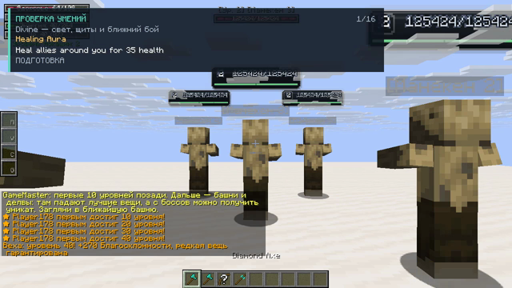
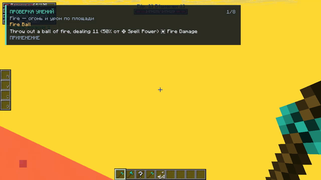
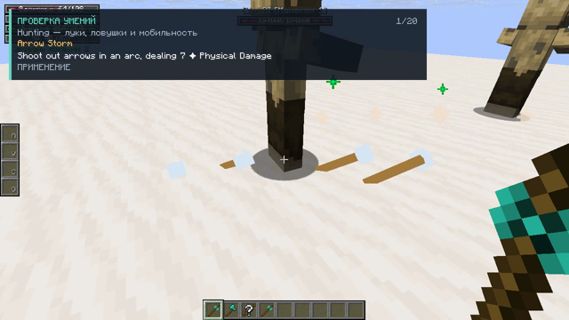
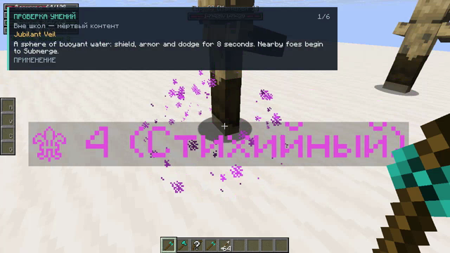
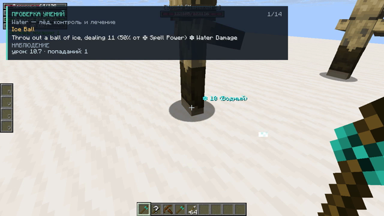

# Аудит умений (все школы заклинаний)

Цель: `all`, клиент под Xvfb, ветка `arena/80a6980a-age-of-epoch`

Обновлено: 2026-11-12 15:33 UTC · коммит `c07c789f2247218dfe655bcaa0b80110c170e9e7` · [прогон](https://github.com/Antoniumu/Age-of-Epoch/actions/runs/43247249487)

Ветку перезаписывает workflow `.github/workflows/spell-audit.yml` при каждом прогоне — здесь всегда последний результат.

**Итог:** `AOEAI done spells=78 passed=74 failed=4`

Умений проверено: **156**, провалилось: **8**.

## Видео по классам

В кадре подпись: название умения, его описание из тултипа и живые цифры (урон, попадания, лечение, эффекты, итог).

### divine

[▶ Смотреть divine.mp4](videos/divine.mp4) · [постер](videos/divine.png)

### fire

[▶ Смотреть fire.mp4](videos/fire.mp4) · [постер](videos/fire.png)

### hunting

[▶ Смотреть hunting.mp4](videos/hunting.mp4) · [постер](videos/hunting.png)

### nature

[▶ Смотреть nature.mp4](videos/nature.mp4) · [постер](videos/nature.png)

### no_school

[▶ Смотреть no_school.mp4](videos/no_school.mp4) · [постер](videos/no_school.png)

### water

[▶ Смотреть water.mp4](videos/water.mp4) · [постер](videos/water.png)

## Живой аудит (замеры в игре)

# Живой аудит заклинаний

Проверено: **78**, прошло: **74**, провалилось: **4**

Колонка «чем подтверждено» — только измеренные факты: урон из событий урона самого умения, лечение и мана из сработавших действий, щит из ресурсов игрока, эффекты и перемещение — по изменению состояния. Умения, у которых снаружи нечего измерить (агро, сброс кулдаунов, меню), помечены явно.

Каждое заклинание применялось тем же путём, что и с хотбара (`setToCast` → тик каста → `Spell.cast`), по манекенам впереди игрока. Если урон не прошёл, делался второй заход с кольцом манекенов вокруг игрока.

Полная таблица: [`reports/spell-audit.md`](reports/spell-audit.md)

## Структурный аудит (без запуска игры)

# Аудит заклинаний (структурный)

Заклинаний: **73**, школ: **5**, ошибок: **0**, предупреждений: **2**

## Предупреждения

- demon: есть в реестре, но не найдено в исходниках заклинаний
- test_spell: есть в реестре, но не найдено в исходниках заклинаний

## По школам

### divine (16)

Полностью: [`reports/spell-audit-structural.md`](reports/spell-audit-structural.md)

## Журналы

* [`logs/aoeai.log`](logs/aoeai.log)
* [`logs/ffmpeg.log`](logs/ffmpeg.log)
* [`logs/gradle.log`](logs/gradle.log)
* [`logs/jstack-spells.txt`](logs/jstack-spells.txt)
* [`logs/latest.log`](logs/latest.log)
* [`logs/steps.log`](logs/steps.log)

