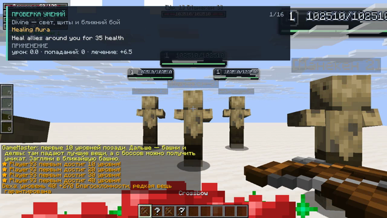
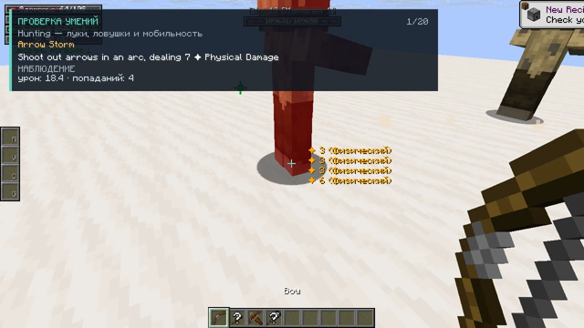

# Аудит умений (все школы заклинаний)

Цель: `all`, клиент под Xvfb, ветка `arena/62df65d6-age-of-epoch`

Обновлено: 2026-11-22 20:38 UTC · коммит `52f47dbfda698a59b6d78a3f6e9e901b833c1b24` · [прогон](https://github.com/Antoniumu/Age-of-Epoch/actions/runs/45066701278)

Ветку перезаписывает workflow `.github/workflows/spell-audit.yml` при каждом прогоне — здесь всегда последний результат.

**Итог:** `AOEAI done spells=78 passed=78 failed=0`

Умений проверено: **156**, провалилось: **0**.

## Видео по классам

В кадре подпись: название умения, его описание из тултипа и живые цифры (урон, попадания, лечение, эффекты, итог).

### divine

[▶ Смотреть divine.mp4](videos/divine.mp4) · [постер](videos/divine.png)

### fire

[▶ Смотреть fire.mp4](videos/fire.mp4) · [постер](videos/fire.png)

### hunting

[▶ Смотреть hunting.mp4](videos/hunting.mp4) · [постер](videos/hunting.png)

### nature

[▶ Смотреть nature.mp4](videos/nature.mp4) · [постер](videos/nature.png)

### no_school

[▶ Смотреть no_school.mp4](videos/no_school.mp4) · [постер](videos/no_school.png)

### water

[▶ Смотреть water.mp4](videos/water.mp4) · [постер](videos/water.png)

## Живой аудит (замеры в игре)

# Живой аудит заклинаний

Проверено: **78**, прошло: **78**, провалилось: **0**

Колонка «чем подтверждено» — только измеренные факты: урон из событий урона самого умения, лечение и мана из сработавших действий, щит из ресурсов игрока, эффекты и перемещение — по изменению состояния. Умения, у которых снаружи нечего измерить (агро, сброс кулдаунов, меню), помечены явно.

Каждое заклинание применялось тем же путём, что и с хотбара (`setToCast` → тик каста → `Spell.cast`), по манекенам впереди игрока. Если урон не прошёл, делался второй заход с кольцом манекенов вокруг игрока.

Полная таблица: [`reports/spell-audit.md`](reports/spell-audit.md)

## Структурный аудит (без запуска игры)

# Аудит заклинаний (структурный)

Заклинаний: **79**, школ: **5**, ошибок: **0**, предупреждений: **8**

## Предупреждения

- jubilant_veil: есть в коде, но нет в реестре (modpack_dev_helper/spells.txt) — список мог устареть
- maelstrom_waltz: есть в коде, но нет в реестре (modpack_dev_helper/spells.txt) — список мог устареть
- slipstream_surge: есть в коде, но нет в реестре (modpack_dev_helper/spells.txt) — список мог устареть
- tidewhip_lash: есть в коде, но нет в реестре (modpack_dev_helper/spells.txt) — список мог устареть
- unbound_joy: есть в коде, но нет в реестре (modpack_dev_helper/spells.txt) — список мог устареть
- undertow_grasp: есть в коде, но нет в реестре (modpack_dev_helper/spells.txt) — список мог устареть

Полностью: [`reports/spell-audit-structural.md`](reports/spell-audit-structural.md)

## Журналы

* [`logs/aoeai.log`](logs/aoeai.log)
* [`logs/ffmpeg.log`](logs/ffmpeg.log)
* [`logs/gradle.log`](logs/gradle.log)
* [`logs/jstack-spells.txt`](logs/jstack-spells.txt)
* [`logs/latest.log`](logs/latest.log)
* [`logs/steps.log`](logs/steps.log)

