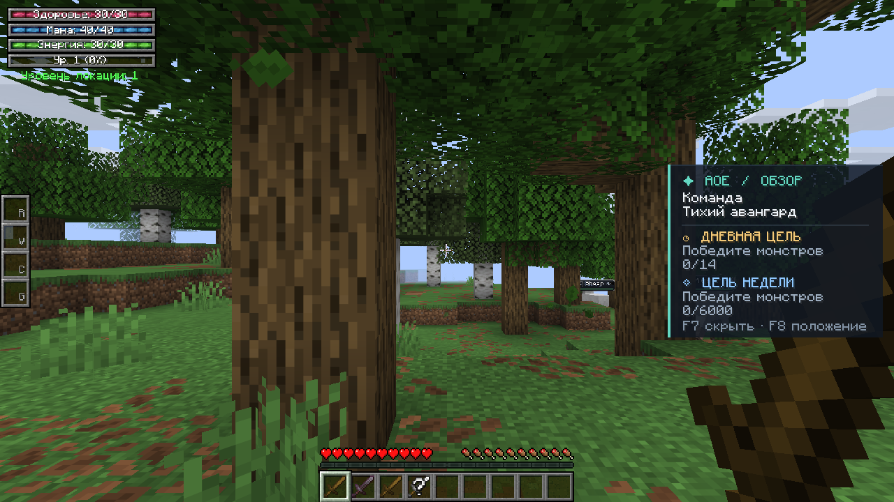

# Скриншоты dev-клиента

Сценарий `boot`, клиент под Xvfb, ветка `arena/d1c5586c-age-of-epoch`

Обновлено: 2026-10-25 20:09 UTC · коммит `45966e01b7b336182009536441210a2a8b80429a` · [прогон](https://github.com/Antoniumu/Age-of-Epoch/actions/runs/40228949407)

Снимков: **22**.

Ветку перезаписывает workflow `.github/workflows/screenshots.yml` при каждом прогоне — здесь всегда последний результат.

## combat-00-main-menu


## combat-01-world-list


## combat-03-in-world


## combat-03b-in-world-created


## combat-04-combat-hud


## combat-05-after-fight



## combat-09-inventory-soulless-decheap


## combat-10-inventory-soulless-neserite


## combat-11-inventory-souled


## combat-12-inventory-soul


## combat-13-hud-hidden


## combat-14-hud-shown


## combat-15-hud-position


## wiki-00-main-menu


## wiki-01-in-world


## wiki-02-hub


## wiki-03-hub-hover-wiki


## wiki-04-wiki


## wiki-05-wiki-page


## wiki-06-wiki-scrolled


## wiki-07-wiki-link-hover


## wiki-08-wiki-linked-page


## Боевые замеры (DPS / лечение)

```
[20:08:38] [Server thread/INFO] (AgeOfEpoch-DevTest) AOETEST старт прогона what=all
[20:08:39] [Server thread/INFO] (AgeOfEpoch-DevTest) AOETEST dps hits=10 requested=400.0 recorded=320.0 elapsed_ms=550 dps_chart=581.8 dps_hud=640.0 fight_active=true check_damage_landed=true check_damage_matches=true check_fight_detected=true check_dps_ratio=true
[20:08:39] [Server thread/INFO] (AgeOfEpoch-DevTest) AOETEST heal max=20.0 before=5.0 after_full=20.0 check_heal_positive=true check_heal_reaches_max=true check_never_above_max=true
[20:08:39] [Server thread/INFO] (AgeOfEpoch-DevTest) AOETEST heal_partial before=5.0 after=15.0 max=20.0 check_partial_increases=true check_partial_below_max=true
[20:08:39] [Server thread/INFO] (AgeOfEpoch-DevTest) AOETEST mana max=40.0 after_spend=0.0 after_restore=40.0 check_spend_works=true check_restore_capped=true
[20:08:39] [Server thread/INFO] (AgeOfEpoch-DevTest) AOETEST team raw=ScТихий___авангард shown=Тихий_авангард long_len=24 max_len=24 check_name_kept=true check_no_format_codes=true check_name_trimmed=true
[20:08:39] [Server thread/INFO] (AgeOfEpoch-DevTest) AOETEST soulless cheap_rank=1 rich_rank=5 cheap_bq=0.12 rich_bq=0.45 cheap_pct=12 rich_pct=45 check_cheap_created=true check_rich_created=true check_rank_order=true check_cheap_is_common=true check_no_affixes=true normal_perc=371 check_quality_set=true check_rolls_not_crippled=true check_plain_name=true
[20:08:39] [Server thread/INFO] (AgeOfEpoch-DevTest) AOETEST soulless_scaling lvl=20 cheap_value=2.0 rich_value=7.3 ratio=3.61 normal_value=17.6 check_below_normal=true check_rich_higher_in_numbers=true check_difference_visible=true
[20:08:39] [Server thread/INFO] (AgeOfEpoch-DevTest) AOETEST soulless_soul lvl_after_low_soul=20 value_after_low_soul=1.9 check_low_soul_keeps_level=true check_low_soul_keeps_stats=true rarity_after=rare affixes_after=2 type_kept=true check_inserted=true check_no_longer_soulless=true check_rarity_from_soul=true check_got_affixes=true check_base_stats_kept=true check_same_item_type=true check_soul_tag_removed=true check_name_changed=true
[20:08:39] [Server thread/INFO] (AgeOfEpoch-DevTest) AOETEST soulless_guards check_trident_untouched=true check_non_gear_untouched=true check_weapon_like_sword=true check_weapon_like_apple_false=true
[20:08:39] [Server thread/INFO] (AgeOfEpoch-DevTest) AOETEST soulless_demo slots=0,1,2,3 check_hotbar_filled=true
[20:08:39] [Server thread/INFO] (AgeOfEpoch-DevTest) AOETEST summary checks=40 failed=0
AOETEST dps hits=10 requested=400.0 recorded=320.0 elapsed_ms=801 dps_chart=399.5 dps_hud=640.0 fight_active=true check_damage_landed=true check_damage_matches=true check_fight_detected=true check_dps_ratio=true
AOETEST heal max=20.0 before=5.0 after_full=20.0 check_heal_positive=true check_heal_reaches_max=true check_never_above_max=true
AOETEST heal_partial before=5.0 after=15.0 max=20.0 check_partial_increases=true check_partial_below_max=true
AOETEST mana max=40.0 after_spend=0.0 after_restore=40.0 check_spend_works=true check_restore_capped=true
AOETEST team raw=ScТихий___авангард shown=Тихий_авангард long_len=24 max_len=24 check_name_kept=true check_no_format_codes=true check_name_trimmed=true
AOETEST soulless cheap_rank=1 rich_rank=5 cheap_bq=0.12 rich_bq=0.45 cheap_pct=12 rich_pct=45 check_cheap_created=true check_rich_created=true check_rank_order=true check_cheap_is_common=true check_no_affixes=true normal_perc=581 check_quality_set=true check_rolls_not_crippled=true check_plain_name=true
AOETEST soulless_scaling lvl=20 cheap_value=1.8 rich_value=6.7 ratio=3.77 normal_value=17.4 check_below_normal=true check_rich_higher_in_numbers=true check_difference_visible=true
AOETEST soulless_soul lvl_after_low_soul=20 value_after_low_soul=1.5 check_low_soul_keeps_level=true check_low_soul_keeps_stats=true rarity_after=rare affixes_after=2 type_kept=true check_inserted=true check_no_longer_soulless=true check_rarity_from_soul=true check_got_affixes=true check_base_stats_kept=true check_same_item_type=true check_soul_tag_removed=true check_name_changed=true
AOETEST soulless_guards check_trident_untouched=true check_non_gear_untouched=true check_weapon_like_sword=true check_weapon_like_apple_false=true
AOETEST soulless_demo slots=0,1,2,3 check_hotbar_filled=true
AOETEST summary checks=40 failed=0
AOETEST dps hits=10 requested=400.0 recorded=320.0 elapsed_ms=550 dps_chart=581.8 dps_hud=640.0 fight_active=true check_damage_landed=true check_damage_matches=true check_fight_detected=true check_dps_ratio=true
AOETEST soulless cheap_rank=1 rich_rank=5 cheap_bq=0.12 rich_bq=0.45 cheap_pct=12 rich_pct=45 check_cheap_created=true check_rich_created=true check_rank_order=true check_cheap_is_common=true check_no_affixes=true normal_perc=371 check_quality_set=true check_rolls_not_crippled=true check_plain_name=true
AOETEST soulless_scaling lvl=20 cheap_value=2.0 rich_value=7.3 ratio=3.61 normal_value=17.6 check_below_normal=true check_rich_higher_in_numbers=true check_difference_visible=true
AOETEST soulless_soul lvl_after_low_soul=20 value_after_low_soul=1.9 check_low_soul_keeps_level=true check_low_soul_keeps_stats=true rarity_after=rare affixes_after=2 type_kept=true check_inserted=true check_no_longer_soulless=true check_rarity_from_soul=true check_got_affixes=true check_base_stats_kept=true check_same_item_type=true check_soul_tag_removed=true check_name_changed=true
```

## Диагностика

* [`logs/aoetest.log`](logs/aoetest.log)
* [`logs/gradle.log`](logs/gradle.log)
* [`logs/graphics.txt`](logs/graphics.txt)
* [`logs/key-lines.log`](logs/key-lines.log)
* [`logs/latest.log`](logs/latest.log)
* [`logs/steps-combat.log`](logs/steps-combat.log)
* [`logs/steps-wiki.log`](logs/steps-wiki.log)
* [`logs/xdpyinfo.txt`](logs/xdpyinfo.txt)
* [`logs/xvfb.log`](logs/xvfb.log)
