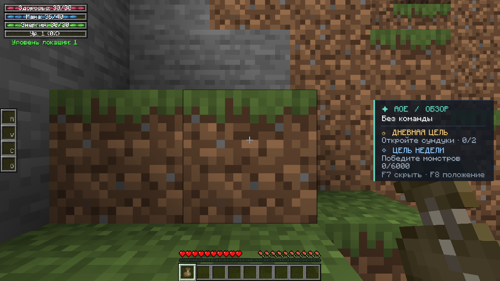
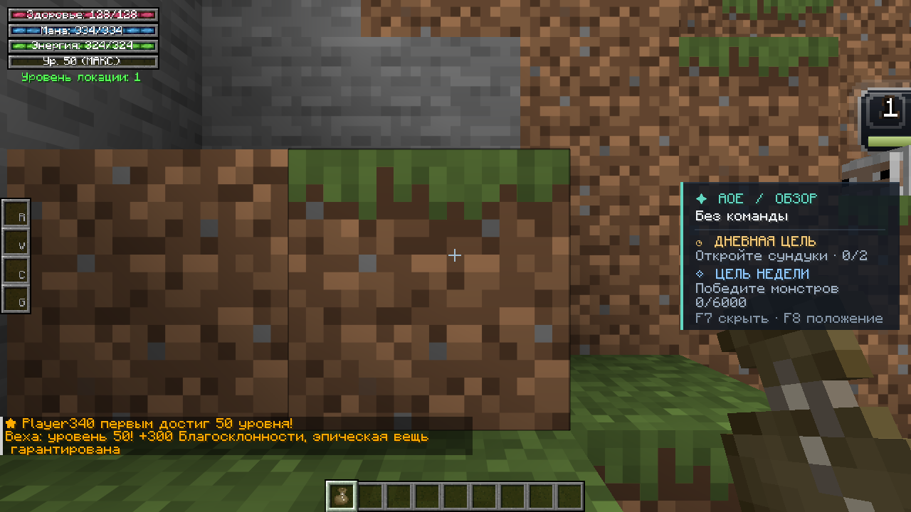
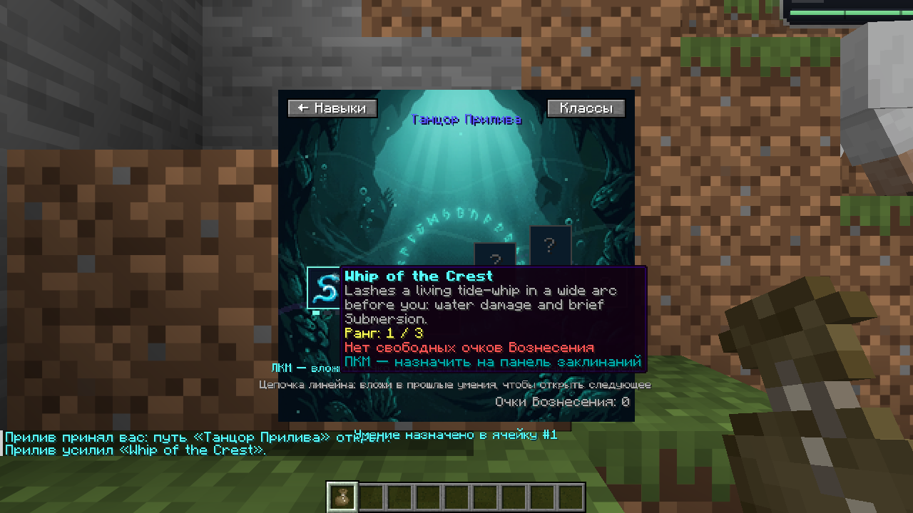
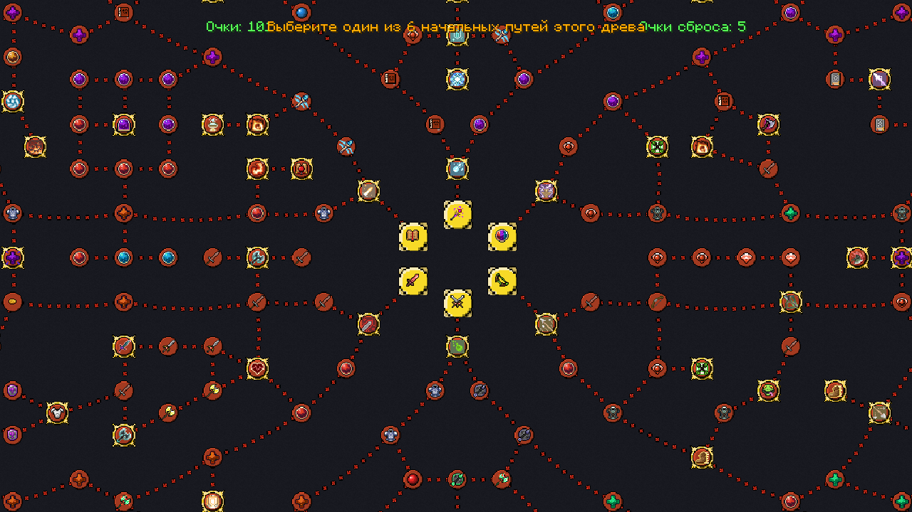
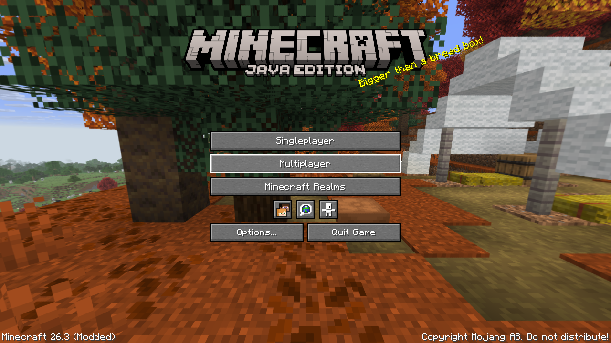
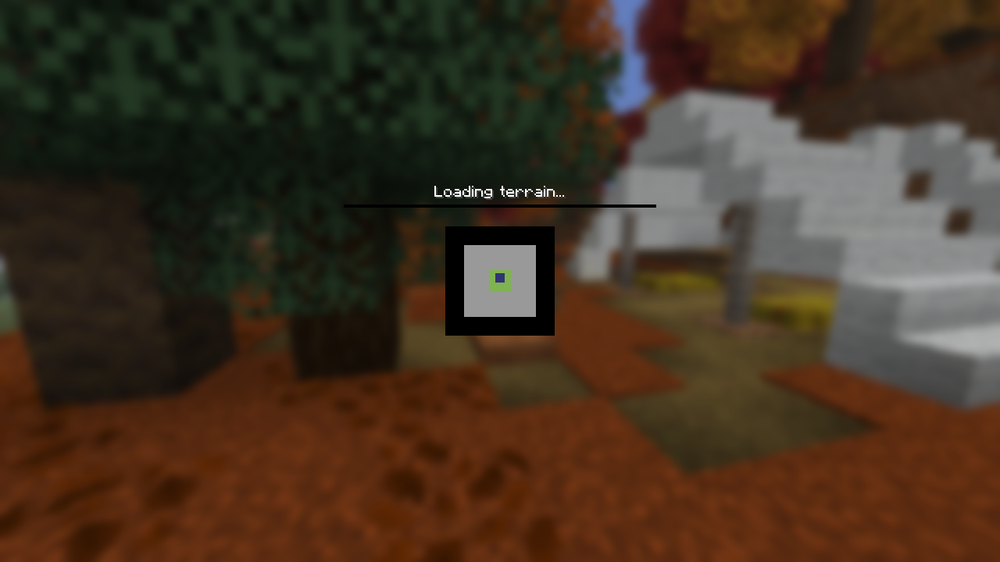
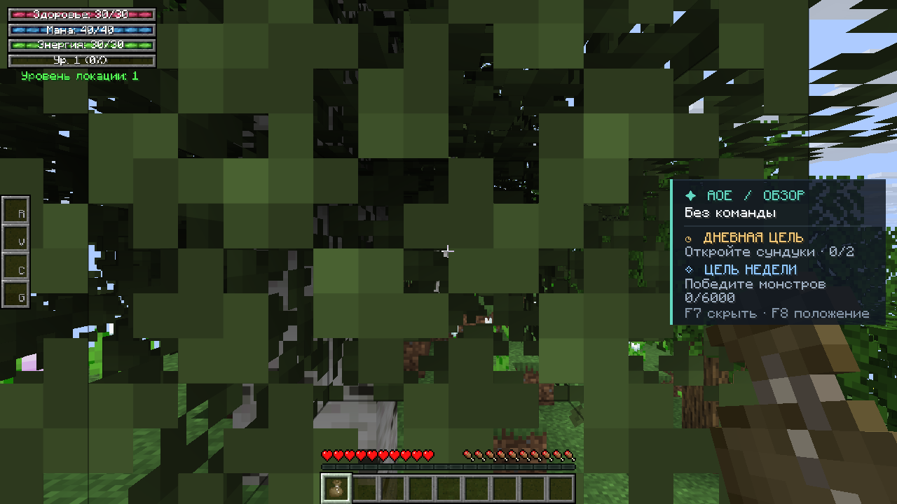
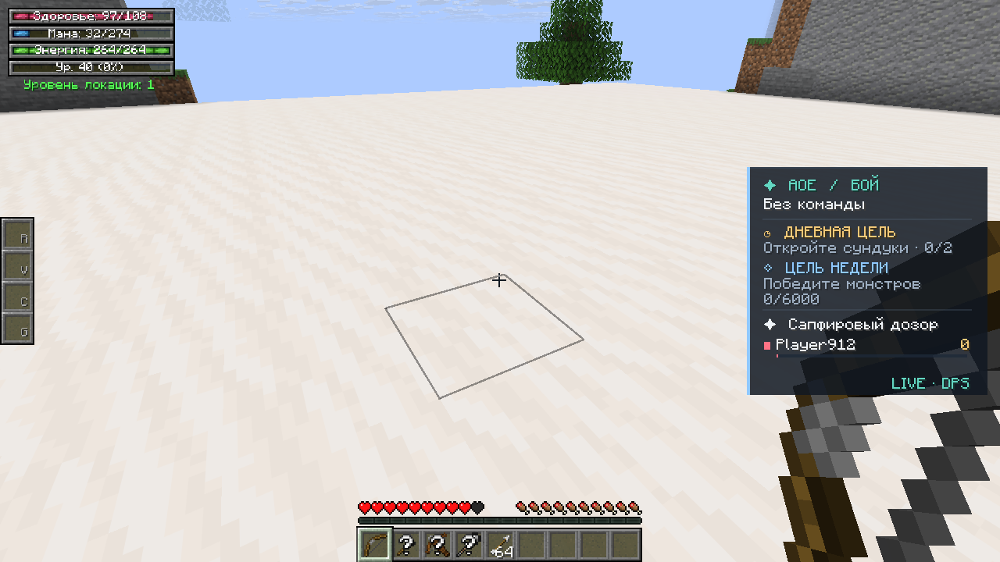

# Полный цикл: прокачка, GUI и умения — видео и снимки

Обновлено: 2026-11-21 01:36 UTC · коммит `a236435453e0fc7d1e71c982784a0ea674271ac2` · [прогон](https://github.com/Antoniumu/Age-of-Epoch/actions/runs/44840443672)

Ветку перезаписывает workflow `.github/workflows/gameplay-e2e.yml` — здесь всегда последний результат.

## 1. Прокачка (видео по этапам)

Каждый ролик — этап: набор опыта (в кадре «+N опыта» и level-up), вложение очков, выбор пути Вознесения, цепочка умений, хотбар.

* [▶ audit-all](videos/progression/audit-all.mp4) · [постер](videos/progression/audit-all.png)

## 2. Клики в GUI (видео)

Сценарий кликает настоящей мышью по реальным координатам виджетов (дамп клиента),
а сервер подтверждает каждый пакет строкой `AOEGUI packet=... ok=...`.

[▶ Смотреть gui-video.mp4](videos/gui/gui-video.mp4)

## 3. Все умения (видео по классам)

* [▶ audit-all](videos/spells/audit-all.mp4) · [постер](videos/spells/audit-all.png)

## Снимки (28)

**gui-00-main-menu**

**gui-01-world-list**

**gui-02-in-world**

**gui-02b-in-world-created**

**gui-05-progressed-to-50**

**gui-10-character-screen**

**gui-11-stat-allocated**

**gui-20-spell-screen**

**gui-21-spell-learned**

**gui-30-ascension-classes**

**gui-31-path-picked**

**gui-32-node-allocated**

**gui-33-node-hotbar**

**gui-40-talents-screen**

**progression-00-main-menu**

**progression-01-world-list**

**progression-02-in-world**

**progression-02b-in-world-created**

**progression-10-level-10-hud**

**progression-11-level-10-character**

**progression-20-level-25-hud**

**progression-21-level-25-character**

**spells-00-main-menu**

**spells-01-world-list**

**spells-02-create-world**

**spells-03-in-world**

**spells-04-audit-done**

**spells-05-character**

