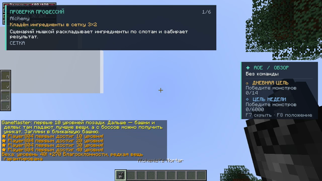
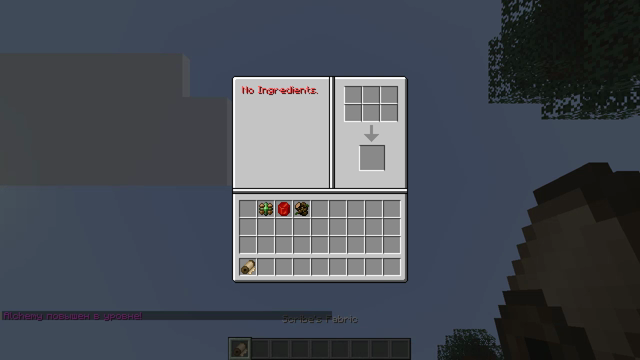
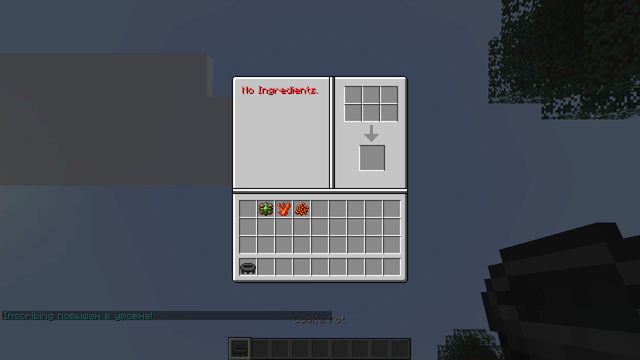
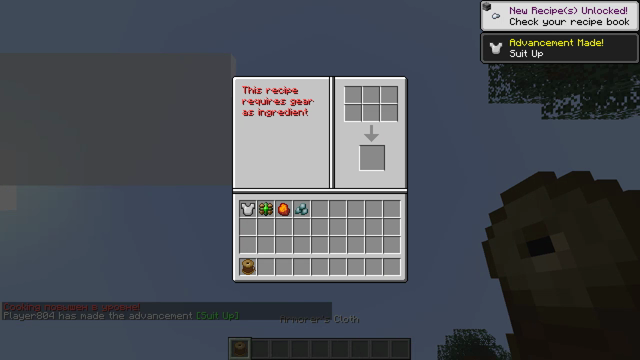
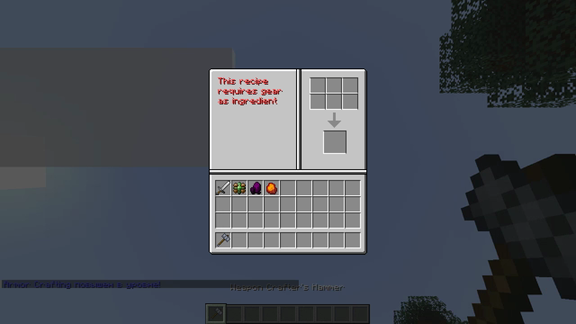
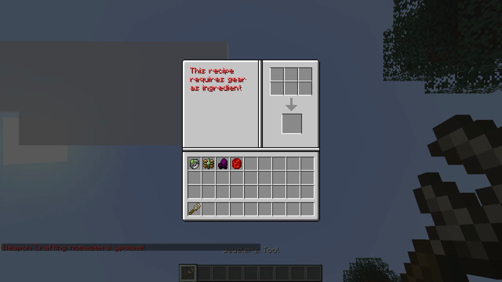

# Видео: проверка всех профессий ремесла

Проверено профессий: **6**, провалилось: **0**.

Каждый ролик — одна профессия. В кадре видно, как предметы мышкой кладутся в сетку крафта 3×2 (каждое перемещение — отдельный скриншот в ветке), сколько статов дал крафт и чем подтверждён результат.

| профессия | ролик | итог |
|---|---|---|
| Alchemy | [alchemy.mp4](alchemy.mp4) | PASS |
| Inscribing | [inscribing.mp4](inscribing.mp4) | PASS |
| Cooking | [cooking.mp4](cooking.mp4) | PASS |
| Armor Crafting | [armor_craft.mp4](armor_craft.mp4) | PASS |
| Weapon Crafting | [wep_craft.mp4](wep_craft.mp4) | PASS |
| Jewel Crafting | [jewel_craft.mp4](jewel_craft.mp4) | PASS |

## Alchemy — зелья: ингредиенты → расходник с эффектом

[alchemy.mp4](alchemy.mp4) · [постер](alchemy.png)

| шаг | итог |
|---|---|
| сложено в сетку | 3 |
| результат появился | да |
| результат забран | да |
| предмет создан | mmorpg:craft_result/alchemy/1 (3) |
| опыт профессии | да |
| итог | **PASS** |

## Inscribing — свитки: ингредиенты → групповой бафф

[inscribing.mp4](inscribing.mp4) · [постер](inscribing.png)

| шаг | итог |
|---|---|
| сложено в сетку | 3 |
| результат появился | да |
| результат забран | да |
| предмет создан | mmorpg:craft_result/inscribing/2 (2) |
| опыт профессии | да |
| итог | **PASS** |

## Cooking — еда: ингредиенты → длительный бафф

[cooking.mp4](cooking.mp4) · [постер](cooking.png)

| шаг | итог |
|---|---|
| сложено в сетку | 3 |
| результат появился | да |
| результат забран | да |
| предмет создан | mmorpg:craft_result/cooking/4 (3) |
| опыт профессии | да |
| итог | **PASS** |

## Armor Crafting — броня: основа + ингредиенты → зачарованная основа

[armor_craft.mp4](armor_craft.mp4) · [постер](armor_craft.png)

| шаг | итог |
|---|---|
| сложено в сетку | 4 |
| результат появился | да |
| результат забран | да |
| предмет создан | minecraft:iron_chestplate (3) |
| опыт профессии | да |
| итог | **PASS** |

## Weapon Crafting — оружие: основа + ингредиенты → зачарованная основа

[wep_craft.mp4](wep_craft.mp4) · [постер](wep_craft.png)

| шаг | итог |
|---|---|
| сложено в сетку | 4 |
| результат появился | да |
| результат забран | да |
| предмет создан | minecraft:iron_sword (3) |
| опыт профессии | да |
| итог | **PASS** |

## Jewel Crafting — украшения: кольцо/ожерелье + ингредиенты → зачарованная основа

[jewel_craft.mp4](jewel_craft.mp4) · [постер](jewel_craft.png)

| шаг | итог |
|---|---|
| сложено в сетку | 4 |
| результат появился | да |
| результат забран | да |
| предмет создан | mmorpg:jewelry/ring/iron (3) |
| опыт профессии | да |
| итог | **PASS** |

